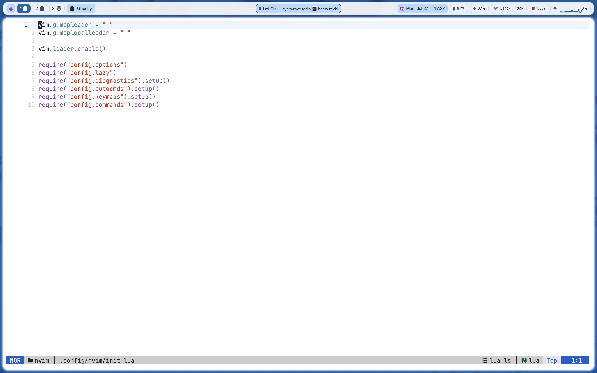
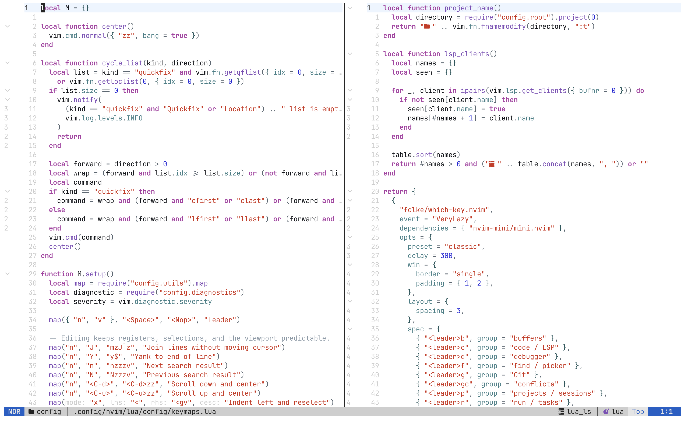
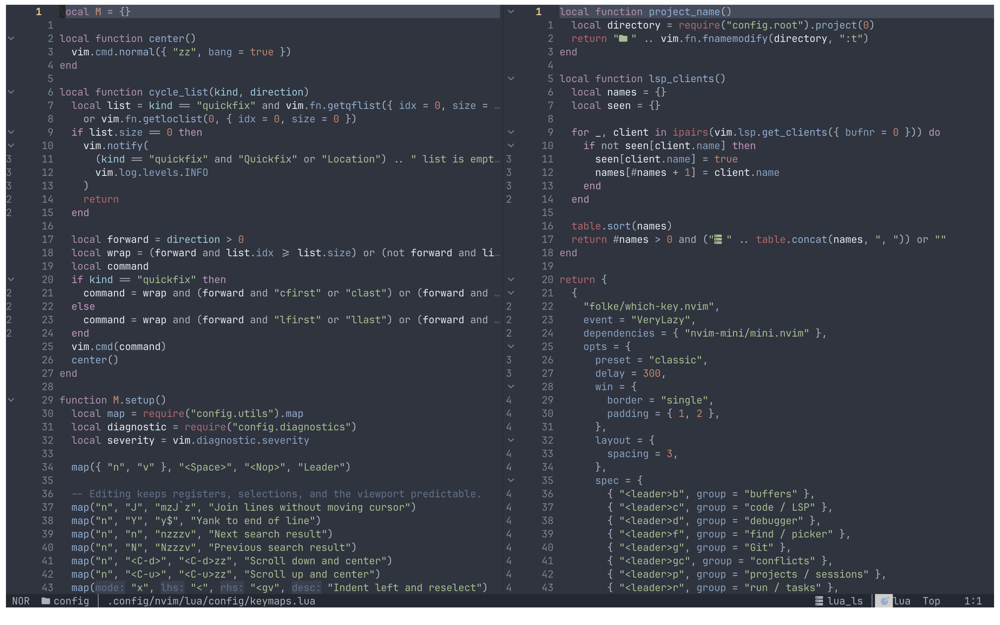
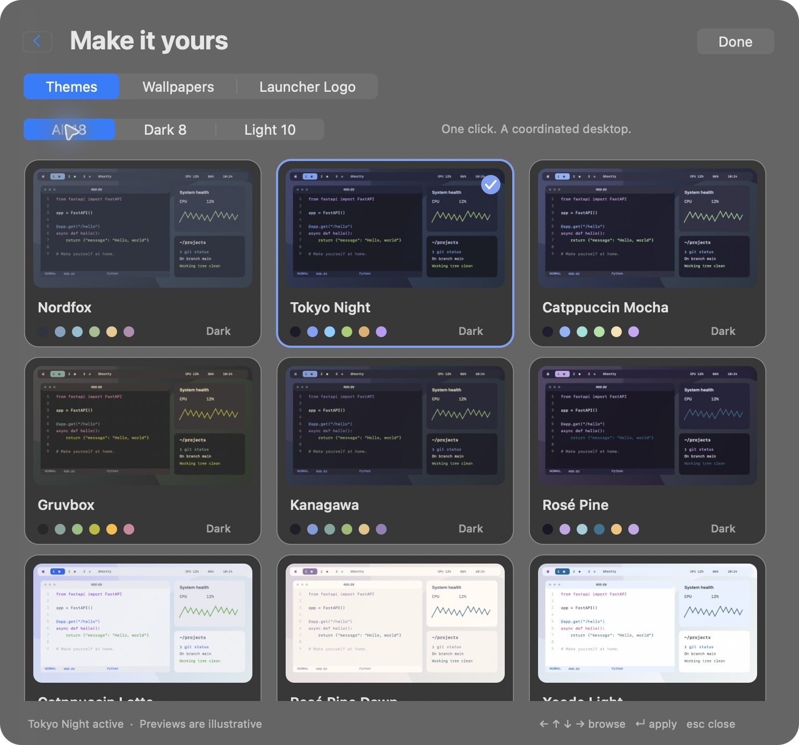

# macOS rice

A keyboard-first macOS desktop with Yabai tiling, a floating SketchyBar,
rounded window borders, Ghostty, and a modular Neovim IDE. Native helpers handle
hover, Space transitions, and a theme coordinator; an AppKit control center
brings the desktop controls together.



| Xcode Light | Nordfox |
| --- | --- |
|  |  |

These are actual desktop screenshots showing the first-run light/dark palettes.
Personal wallpapers and custom launcher artwork are not distributed.

### Native theme picker

Fresh capture of the running AppKit theme picker, shown in Tokyo Night. The
picker includes 18 coordinated palettes, with separate light and dark filters.

<p align="center">
  
</p>

## The desktop

- **Useful Spaces:** numbered desktops keep their identity across monitors.
  Missing desktops are created on demand; pressing the current number returns
  to the previous desktop. Each pill shows compact application icons, up to
  three with an overflow count, and expands on hover.
- **Native interaction:** short, interruptible hover and width animations,
  stable icon order, and atomic Space-strip updates. Desktop mutations run
  separately from the pointer event loop.
- **Control center:** an AppKit panel for system load, memory, storage, battery,
  audio, displays, network/VPN status, and shortcuts to system settings.
- **Personalization:** a native gallery with theme previews, wallpaper
  thumbnails, and a configurable launcher logo.
- **One palette across the stack:** 18 themes, including 10 light themes.
  Selecting one updates SketchyBar, borders, Ghostty, and Neovim, and selects
  the matching macOS light/dark appearance. Other apps follow macOS appearance
  where they support it.
- **Live telemetry:** CPU graph, RAM usage, network throughput, battery, volume,
  clock, and a media island that disappears when nothing is playing.
- **A working editor:** native LSP, completion, formatting, linting, Git,
  debugging, tests, tasks, sessions, and sticky code context.
  See the [Neovim guide](nvim/README.md).

| Component | Configuration |
| --- | --- |
| [Yabai](https://github.com/asmvik/yabai) | [yabai/yabairc](yabai/yabairc) |
| [skhd](https://github.com/asmvik/skhd) | [skhd/skhdrc](skhd/skhdrc) |
| [SketchyBar](https://github.com/FelixKratz/SketchyBar) | [sketchybar/sketchybarrc](sketchybar/sketchybarrc) |
| [JankyBorders](https://github.com/FelixKratz/JankyBorders) | [borders/bordersrc](borders/bordersrc) |
| [Ghostty](https://github.com/ghostty-org/ghostty) | [ghostty/config.ghostty](ghostty/config.ghostty) |
| [Neovim](https://neovim.io/) | [nvim/](nvim/) |

## Setup

Currently targets **Apple Silicon macOS with Homebrew at `/opt/homebrew`**.
Tested on macOS Tahoe 26.5/26.6. Intel Macs and other platforms need path and
platform changes; the installer deliberately rejects them rather than claiming
support. Advanced desktop operations depend on Yabai's compatibility with your
macOS version.

Install [Homebrew](https://brew.sh/) and Apple's Command Line Tools
(`xcode-select --install`) first. Then:

```sh
git clone https://github.com/deniserdogan/dotfiles.git ~/dotfiles
cd ~/dotfiles

# Review the installer and the proposed changes.
less setup.sh
./setup.sh --dry-run

# Install dependencies, build helpers, and link configs.
./setup.sh
```

The installer:

1. Installs the [Brewfile](Brewfile) dependencies without requesting a blanket
   upgrade of existing packages.
2. Compiles the native helpers locally, **before** replacing any configs.
3. Links `borders`, `ghostty`, `nvim`, `sketchybar`, `skhd`, and `yabai`
   into `~/.config`. Conflicts—including broken symlinks—are moved into a
   unique `~/.config/dotfiles-backup.*` directory, never deleted.
4. Installs the bundled Rice App Icons font, preserving a different existing
   copy in the same backup directory.
5. Creates empty private wallpaper, logo, and cache folders.

Running it again keeps correct links and identical fonts. A checkout directly
at `~/.config` also works: the installer leaves those directories in place.
Existing users of the old nested `.config/` repository layout should rerun setup
after pulling.

**Services are not started by default.** Setup does not change your wallpaper,
logo, appearance, Accessibility permissions, SIP, or sudoers.
Homebrew may still upgrade a dependency if an installation requires it.

### macOS settings and permissions

Before starting services:

- In **Desktop & Dock → Mission Control**, enable **Displays have separate
  Spaces** and disable **Automatically rearrange Spaces based on most recent
  use**. Log out/in if macOS requests it.
- Set the macOS menu bar to hide automatically so it does not overlap
  SketchyBar. The setting is under **Menu Bar** or **Control Center**, depending
  on your macOS version.
- Allow Yabai and skhd under **Privacy & Security → Accessibility**. You may
  need to launch each once to make it appear, then restart it after granting
  access.
- If Mission Control has conflicting `Cmd + number` shortcuts, disable or
  reassign them under **Keyboard → Keyboard Shortcuts**.

Now explicitly start/restart the desktop services:

```sh
./setup.sh --skip-packages --start-services
./setup.sh --doctor
```

Yabai starts JankyBorders from its config; do not also start a second Borders
service. Open Ghostty and launch `nvim`; lazy.nvim and Mason bootstrap editor
dependencies. Run `:ConfigHealth` and `:checkhealth` after the first install.
Language tools may also need their runtimes, such as Node.js, Go, or Python;
see the [editor toolchain guide](nvim/README.md).

### Optional: advanced Space operations

Basic tiling and many window actions work without a scripting addition.
Creating/deleting/moving Spaces and some focus operations require Yabai's
scripting addition and its additional permissions. On supported macOS
versions this involves **partially disabling SIP**, a meaningful security
tradeoff.

The installer never does that for you. Follow the official
[SIP documentation](https://github.com/asmvik/yabai/wiki/Disabling-System-Integrity-Protection)
and [scripting-addition setup](https://github.com/asmvik/yabai/wiki/Installing-yabai-%28latest-release%29#configure-scripting-addition)
for your exact macOS and Yabai version. Use the documented hash-pinned sudoers
rule, not an unrestricted sudo grant, and refresh the hash after Yabai updates.
Machine-specific loaders and sudoers files are excluded from this repository.

## Personalize

Click the top-left launcher, then **Personalize your desktop**.

### Themes

The gallery shows rendered palette previews and remembers one light and one
dark theme. `Ctrl + Left Option + Cmd + T` toggles between those selections.
Changing appearance in macOS Settings follows the same coordinator; no terminal
restart is needed.

Light: Catppuccin Latte, Rosé Pine Dawn, Xcode Light, Dayfox, Dawnfox, Tokyo Night
Day, Kanagawa Lotus, Gruvbox Light, GitHub Light, and Everforest Light.

Dark: Nordfox, Tokyo Night, Catppuccin Mocha, Gruvbox, Kanagawa, Rosé Pine,
Carbonfox, and Catppuccin Macchiato.

The [theme catalog](sketchybar/themes/catalog.json) is the source of truth.
Ghostty uses 90% background opacity; Neovim's transparent background follows the
terminal palette.

### Wallpapers and launcher artwork

The galleries can open their local folders:

```text
~/.config/rice/
├── wallpapers/           your downloaded wallpapers
├── logos/                your custom launcher artwork
├── cache/                generated previews
├── personalization.json  local wallpaper/logo preferences
└── theme-selection.json  remembered light/dark themes
```

Folder changes refresh the gallery automatically. Wallpaper selection applies
to the current desktop on the selected display(s). PNG, SVG, and PDF work well
for logos; transparent artwork is best for the optional **Use theme color**
tint. **Apple (default)** restores the standard launcher.

Everything under `rice/` is ignored by Git, including artwork, previews, and
preferences. A new installation starts with the Apple logo and does not receive
any personal images. The picker reads local files; it does not upload them.

## Keyboard controls

`Option` below means **Left Option**. Right Option remains available to Ghostty
for terminal Alt bindings. These are global shortcuts, so review
[skhd/skhdrc](skhd/skhdrc) for conflicts with your apps.

| Shortcut | Action |
| --- | --- |
| `Option H/J/K/L` | Focus left/down/up/right, with wraparound |
| `Shift Option H/J/K/L` | Warp the window within the BSP tree |
| `Ctrl Option H/J/K/L` | Resize an edge by 40 px |
| `Option F` | Toggle Yabai zoom (not a macOS fullscreen Space) |
| `Option Space` | Toggle floating |
| `Option S` | Toggle split orientation |
| `Shift Option S` | Stack the focused window, or detach it into its own tile |
| `Option [ / ]` | Cycle stack members, wrapping at either end |
| `Option R` / `Option B` | Rotate / balance layout |
| `Shift Option X / Y` | Mirror layout |
| `Cmd 1…9` | Focus a numbered Space; create missing desktops up to that number |
| `Shift Cmd 1…9` | Move the focused window to a numbered Space |
| `Shift Option N` | Create a Space on the focused display |
| `Shift Option Backspace` | Delete the current Space; keep the last one per display |
| `Cmd Option H/J/K/L` | Focus the display in that direction |
| `Cmd Option M` | Cycle display focus |
| `Shift Cmd Option H/J/K/L` | Move the current Space to that display |
| `Shift Cmd Option B` | Move the current Space to the built-in display |
| `Shift Option M` | Repeatedly cycle the current Space through connected displays |
| `Cmd Shift S` | Select a screenshot area → clipboard; Esc cancels, Space selects a window |
| `Ctrl Option Cmd T` | Toggle remembered light/dark themes |
| `Ctrl Option Cmd S` | Reload SketchyBar |
| `Ctrl Option Cmd R` | Restart Yabai |

`Cmd Shift S` replaces apps' usual Save As binding. Option + left/right mouse
drag moves/resizes a window. Pressing the current Space number again returns
to the previous one. Semantic Space numbers follow a desktop between monitors,
rather than referring to its temporary Mission Control index.

For Neovim, `Space` is the leader key. `gcc` toggles a line comment and visual
`gc` comments a selection. The complete keymaps and language configuration are
in [nvim/README.md](nvim/README.md).

## Maintenance and troubleshooting

After pulling updates, rebuild helpers and reload the bar:

```sh
git pull --ff-only
./setup.sh --skip-packages
sketchybar --reload
```

If Yabai/skhd configs changed, use the explicit `--start-services` option too.
The installer reports where any old configs were backed up. To undo a linked
install, stop the services, move the new config symlinks aside, and restore the
matching backup directories. Do not move a live `~/.config` checkout wholesale.

| Symptom | Check |
| --- | --- |
| Hotkeys do nothing | skhd Accessibility permission; Secure Keyboard Entry and shortcut conflicts |
| Windows do not tile | Yabai Accessibility permission; restart Yabai after granting it |
| Space create/delete/move fails | macOS/Yabai compatibility, scripting addition, SIP, current sudoers hash |
| Missing native helper | Run `./setup.sh --skip-packages` |
| App icons are boxes | Install the bundled Rice App Icons and JetBrainsMono Nerd Font; log out/in if necessary |
| Theme is out of sync | Reload SketchyBar, then run `~/.config/sketchybar/helpers/native_theme --sync` |
| Bar missing or stale | Run `./setup.sh --doctor`; inspect SketchyBar/helper logs |
| Neovim tooling missing | `:ConfigHealth`, `:MasonToolsInstall`, `:checkhealth`; check language runtimes |

Layout spacing lives in [yabai/yabairc](yabai/yabairc); bar fonts, widgets, and
geometry live in [sketchybar/sketchybarrc](sketchybar/sketchybarrc). App glyph
overrides are in [icon_map.sh](sketchybar/plugins/icon_map.sh). The native helper
architecture and local log locations are documented [here](sketchybar/helpers/README.md).

### Checks

The installer suite uses temporary roots and fake service commands. The default
helper suite performs read-only checks; tests that change the desktop are opt-in.

```sh
bash -n setup.sh
python3 -m unittest discover -s tests -p '*_test.py'
python3 -m unittest discover -s sketchybar/helpers/tests -p '*_test.py'
```

Build the helpers before running their tests. Do not enable
`RICE_THEME_LIVE_TESTS` during normal checks: that suite deliberately switches
the running desktop through every theme.

## Credits and licenses

Built on [Yabai and skhd](https://github.com/asmvik),
[SketchyBar and JankyBorders](https://github.com/FelixKratz),
[Ghostty](https://github.com/ghostty-org/ghostty), [Neovim](https://neovim.io/),
and the plugin authors represented in [lazy-lock.json](nvim/lazy-lock.json).

Configuration: [MIT](LICENSE). Native helpers and the vendored SketchyBar IPC
header: [GPL-3.0](sketchybar/helpers/vendor/LICENSE). The bundled app-icon font
is derived from [sketchybar-app-font](https://github.com/kvndrsslr/sketchybar-app-font):
[CC0-1.0](sketchybar/fonts/LICENSE).
