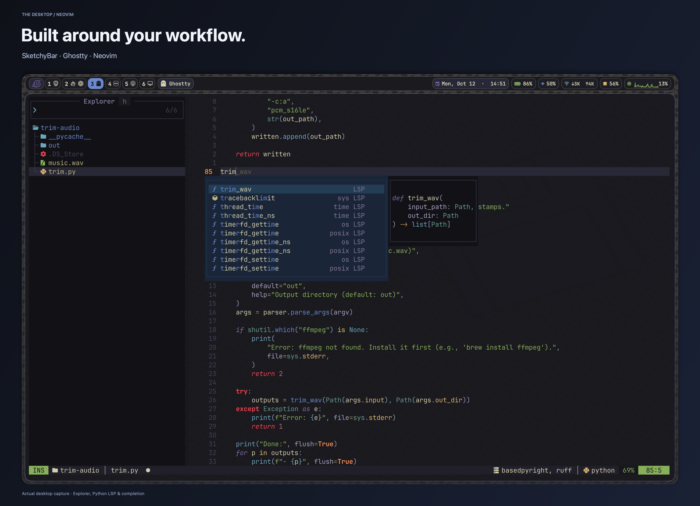
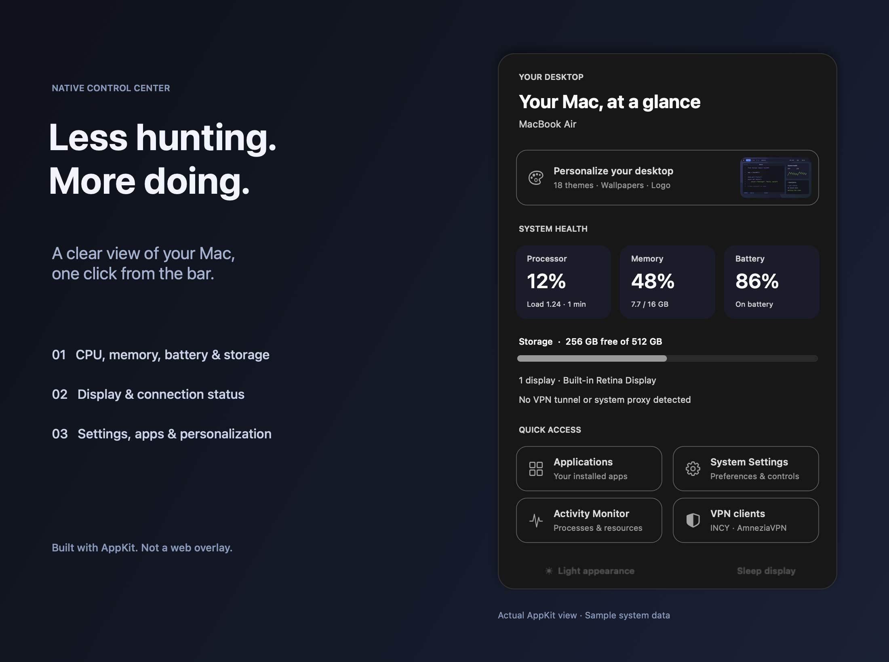
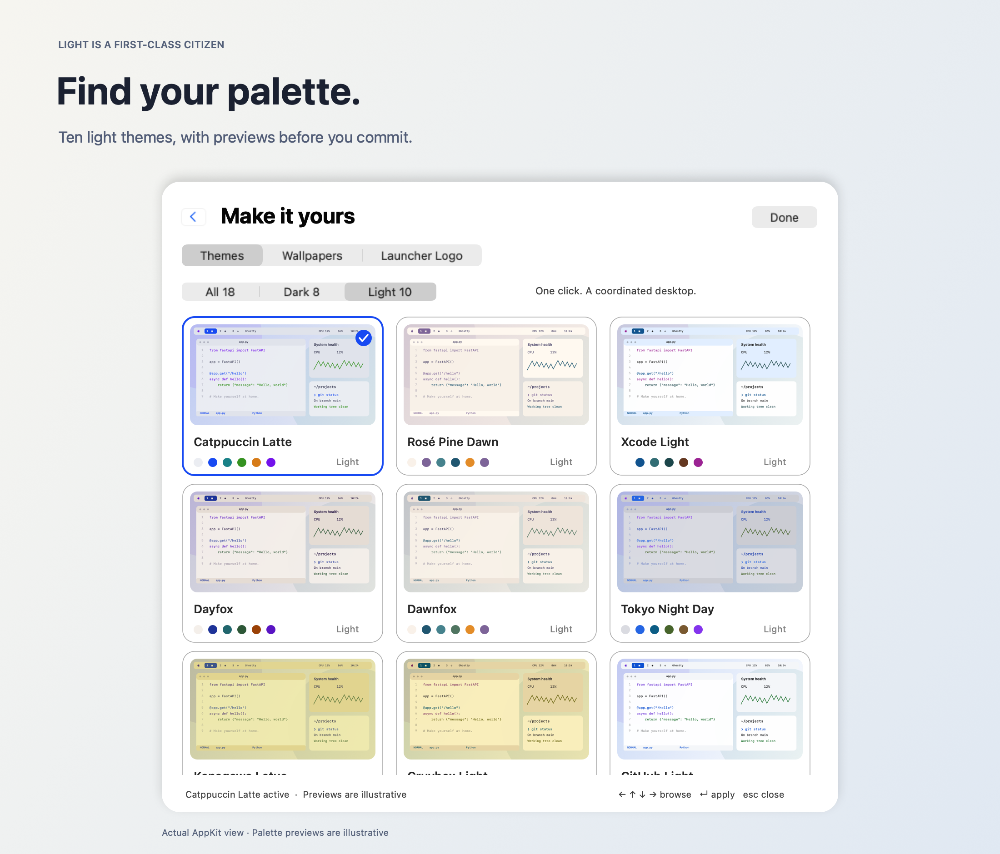
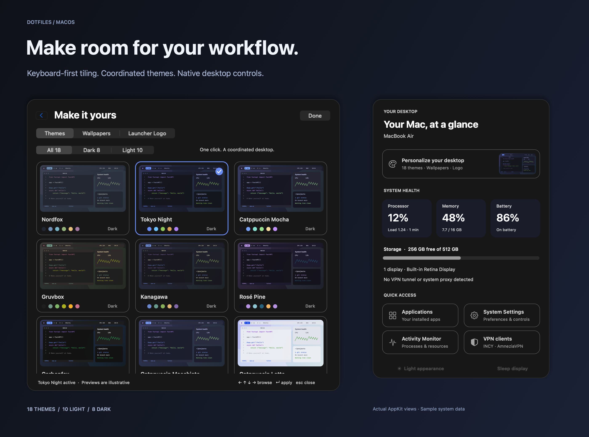

<div align="center">

# macOS dotfiles

A keyboard-first desktop, with a native feel.

Yabai tiling · SketchyBar · AppKit controls · Ghostty · Neovim

[Install](docs/SETUP.md) · [Shortcuts](docs/KEYBINDINGS.md) · [Personalize](docs/PERSONALIZATION.md) · [Neovim](nvim/README.md)

</div>



<sub>Actual desktop capture, framed for presentation. Explorer, Python LSP,
completion, and live system telemetry—all from the running setup.</sub>

An integrated macOS setup for people who live between an editor, a terminal,
and a browser. Keep your hands on the keyboard, your Spaces organized, and
your applications in the same palette.

## A desktop that works together

**Spaces with a memory.** Jump with `Cmd 1…9`. Missing desktops are created
on demand; press the current number again to return to the previous Space.
Numbers follow their desktops between displays—not Mission Control's changing
indices. Compact app icons expand on hover, with an overflow count for busy Spaces.

**Motion without the detour.** Compiled native helpers handle hover, icon-strip
updates, and Space coordination. Pointer events stay off the shell path;
desktop operations run separately. Short transitions keep the bar responsive
while preserving visual continuity.

**One palette, end to end.** Pick a theme once to coordinate SketchyBar,
window borders, Ghostty, Neovim, and macOS light/dark appearance. The native
gallery remembers your preferred light and dark themes.

**An editor ready for work.** A modular Neovim configuration with LSP,
completion, formatting, Git, debugging, tests, tasks, sessions, and sticky
code context. [Explore the editor →](nvim/README.md)

## Your Mac, at a glance



Click the launcher for CPU load, memory, battery, storage, display information,
and detected VPN/proxy status. Open settings, Activity Monitor, applications,
or your VPN client from the same panel.

The bar keeps the everyday signals visible: a CPU graph, RAM usage, network
throughput, battery, volume, and time. A media island appears while audio is playing.

## Light themes deserve the same attention



**18 coordinated themes: 10 light, 8 dark.** Browse visual previews, filter by
appearance, and apply with a click. `Ctrl + Left Option + Cmd + T` switches
between your remembered pair; macOS appearance changes use the same coordinator.

Bring your own wallpapers and launcher artwork. The galleries read local
folders, refresh when files change, and keep personal images and preferences
out of Git. Fresh installations use the standard Apple launcher.

[Theme list, wallpapers, and custom logos →](docs/PERSONALIZATION.md)

<details>
<summary>View the dark theme gallery and control center together</summary>



</details>

<sub>The panel showcases render actual AppKit views with sample system data and
an opaque documentation backdrop. Their palette thumbnails are illustrative;
the desktop image above is a real capture. Personal artwork visible in that
capture is not distributed as separate wallpaper or logo assets.
[Reproduce the visuals](docs/media/README.md).</sub>

## Get started

Targets **Apple Silicon macOS**, with Homebrew at `/opt/homebrew` and Apple's
Command Line Tools installed. Review the installer before running it:

```sh
git clone https://github.com/deniserdogan/dotfiles.git ~/dotfiles
cd ~/dotfiles
less setup.sh
./setup.sh --dry-run
./setup.sh
```

Setup installs dependencies, builds the native helpers, backs up conflicting
configs, links the six components, and installs the app-icon font. It does
**not** start services or change permissions, SIP, appearance, or wallpaper.

Follow the [setup guide](docs/SETUP.md) for macOS settings and Accessibility
permissions, then explicitly start the services:

```sh
./setup.sh --skip-packages --start-services
./setup.sh --doctor
```

> Advanced Space creation, deletion, and movement require Yabai's scripting
> addition. Depending on macOS, that involves partially disabling SIP—a security
> tradeoff, not an automatic installation step. Read the
> [requirements and limitations](docs/SETUP.md#advanced-space-operations) first.

## Learn the essentials

`Option` here means **Left Option**; Right Option stays available to the terminal.

| Shortcut | Action |
| --- | --- |
| `Option H / J / K / L` | Focus windows with wraparound |
| `Cmd 1…9` | Jump to a Space; create missing desktops |
| `Shift Cmd 1…9` | Send a window to a Space |
| `Option F` | Zoom the focused tile |
| `Shift Option S` | Stack / unstack a window |
| `Option [ / ]` | Cycle through a stack |
| `Shift Option M` | Move the Space through connected monitors |
| `Ctrl Option Cmd T` | Switch light / dark theme |

[All shortcuts →](docs/KEYBINDINGS.md)

## Make it yours

| Component | What it handles | Configuration |
| --- | --- | --- |
| [Yabai](https://github.com/asmvik/yabai) | Tiling, layouts, Spaces, displays | [yabairc](yabai/yabairc) |
| [skhd](https://github.com/asmvik/skhd) | Global keyboard controls | [skhdrc](skhd/skhdrc) |
| [SketchyBar](https://github.com/FelixKratz/SketchyBar) | Floating bar and live widgets | [sketchybarrc](sketchybar/sketchybarrc) |
| [JankyBorders](https://github.com/FelixKratz/JankyBorders) | Focused-window outlines | [bordersrc](borders/bordersrc) |
| [Ghostty](https://github.com/ghostty-org/ghostty) | Terminal, palette, transparency | [config.ghostty](ghostty/config.ghostty) |
| [Neovim](https://neovim.io/) | Editor and language tooling | [Editor guide](nvim/README.md) |

The [theme catalog](sketchybar/themes/catalog.json) defines the shared palettes.
The [native-helper guide](sketchybar/helpers/README.md) explains the interaction
architecture. See [maintenance and troubleshooting](docs/MAINTENANCE.md) for
updates, health checks, and recovery.

## Credits & licenses

Built on the projects above and the Neovim plugin authors in
[lazy-lock.json](nvim/lazy-lock.json).

Configuration: [MIT](LICENSE). Native helpers and vendored SketchyBar IPC:
[GPL-3.0](sketchybar/helpers/vendor/LICENSE). The app-icon font derives from
[sketchybar-app-font](https://github.com/kvndrsslr/sketchybar-app-font),
[CC0-1.0](sketchybar/fonts/LICENSE).
